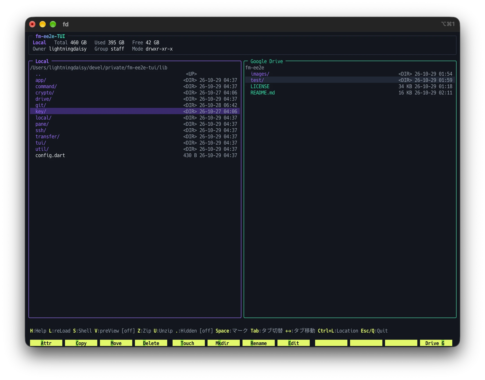

# fm-ee2e-TUI（Swift 版）

Mac のターミナル（文字だけの黒い画面）で動く、ファイルを管理するアプリ（ファイラー）です。



画面が左右2つに分かれていて、ファイルのコピー・移動・削除・名前の変更・編集など、ファイルを管理するのに必要なことはひととおりできます。あとから、Google Drive（暗号化して保存）・Git・SSH・iCloud Drive も使えるようにできます。

> このアプリは **Mac 専用**です。Windows や Linux では動きません。

---

## 目次

**まず動かす**

1. [準備するもの](#1-準備するもの)
2. [ターミナルの使い方（最低限）](#2-ターミナルの使い方最低限)
3. [必要なソフトを入れる](#3-必要なソフトを入れる)
4. [アプリを作る（ビルド）](#4-アプリを作るビルド)
5. [起動する](#5-起動する)
6. [画面の見方](#6-画面の見方)
7. [キー操作](#7-キー操作)

**使えることを増やす（使いたい人だけ）**

8. [右の窓のタブ](#8-右の窓のタブ)
9. [Google Drive を使う（暗号化して保存）](#9-google-drive-を使う暗号化して保存)
10. [Git を使う](#10-git-を使う)
11. [SSH を使う](#11-ssh-を使う)
12. [iCloud Drive を使う](#12-icloud-drive-を使う)
13. [使うタブを選ぶ（設定ファイル）](#13-使うタブを選ぶ設定ファイル)

**その他**

14. [困ったとき](#14-困ったとき)

---

# まず動かす

ここから「5. 起動する」までやれば、アプリが動きます。

## 1. 準備するもの

- Mac（インターネットにつながっていること）
- この `fm-ee2e-swift` フォルダー
- 30分くらいの時間（はじめての場合）

お金はかかりません。

## 2. ターミナルの使い方（最低限）

このアプリは「ターミナル」という、文字だけで Mac を操作するアプリの中で動きます。

**ターミナルを開く**

1. キーボードの `command` を押しながら `スペース` を押します（Spotlight 検索が開きます）。
2. `ターミナル` と入力して `return` を押します。

**コマンドを実行する**

この説明に出てくる、灰色の枠の中の文字（コマンド）を、ターミナルに貼り付けて `return` を押すと実行されます。

- コピーするときは、枠の中の文字を選んで `command` + `C`。
- ターミナルに貼り付けるときは `command` + `V`。
- 1つの枠には1つのコマンドが入っています。1つずつ実行してください。

**パスワードを聞かれたら**

`Password:` と出たら、Mac にログインするときのパスワードを入力して `return` を押します。

- 入力しても画面には何も表示されません（`●` も出ません）。これは正常です。気にせず最後まで打って `return` を押してください。

## 3. 必要なソフトを入れる

### 3-1. Homebrew（ソフトを入れるための道具）

ターミナルで次のコマンドを実行します。

```bash
/bin/bash -c "$(curl -fsSL https://raw.githubusercontent.com/Homebrew/install/HEAD/install.sh)"
```

- 途中でパスワードを聞かれたら、Mac のパスワードを入力します。
- `Press RETURN/ENTER to continue` と出たら `return` を押します。
- 「コマンドライン・デベロッパ・ツール」を入れるか聞かれたら「インストール」を押します。
- 数分〜十数分かかります。

最後に `==> Next steps:` という表示が出て、その下にコマンドが2〜3行出ます。**その行をそのままコピーして、1行ずつ実行してください**（例: `echo >> ...` や `eval "$(...brew shellenv)"` で始まる行）。これをしないと次の手順で `brew` が見つかりません。

確認:

```bash
brew --version
```

`Homebrew 4.x.x` のように表示されれば成功です。

### 3-2. Swift（このアプリを作るための道具）

Homebrew を入れたときに一緒に入る「コマンドライン・デベロッパ・ツール」に入っています。

確認:

```bash
swift --version
```

`Swift version 6.2` 以上の数字が出れば成功です。古いときは、Xcode か「コマンドライン・デベロッパ・ツール」を新しくしてください。

### 3-3. iTerm2（おすすめのターミナル）

Mac に最初から入っている「ターミナル」でも動きますが、**iTerm2** というターミナルアプリのほうが、画面が広く見やすく、画像のプレビューもきれいに出ます。

```bash
brew install --cask iterm2
```

入れたら、アプリケーションフォルダーの「iTerm」を開いて、ここから先はそちらを使ってください（Spotlight で `iterm` と入力しても開けます）。使い方は「ターミナル」と同じです。

## 4. アプリを作る（ビルド）

### 4-1. フォルダーに移動する

ターミナルで `cd`（シーディーと、そのあとに半角スペース1つ）と入力し、**Finder から `fm-ee2e-swift` フォルダーをターミナルの画面にドラッグ＆ドロップ**します。フォルダーの場所が自動で入力されるので、`return` を押します。

確認:

```bash
ls
```

`README.md` や `Package.swift` などの名前が並べば、正しいフォルダーにいます。

> 以降のコマンドは、すべてこのフォルダーにいる状態で実行します。ターミナルを開き直したときは、もう一度 `cd` とドラッグ＆ドロップをしてください。

### 4-2. ビルドする

アプリを作ります（数分かかります）。

```bash
swift build -c release
```

最後に `Build complete!` と出れば成功です。`.build/release` フォルダーの中に `fm-ee2e-tui` というアプリができています。

## 5. 起動する

`fm-ee2e-swift` フォルダーにいる状態で:

```bash
.build/release/fm-ee2e-tui
```

左右の窓に、どちらも `fm-ee2e-swift` フォルダーの中身が並べば成功です。

- ターミナルの窓は大きめにしてください（小さすぎると「端末が小さすぎます」と出ます）。
- 終わるときは `Q` を押し、確認が出たら `return` を押します。

ここまでで、アプリは動きます。

## 6. 画面の見方

```
╭─ fm-ee2e-TUI ────────────────────────────────────────────────╮
│ Local   Total 460 GB   Used 395 GB   Free 42 GB                │  ← 選んでいる窓のディスクの容量
│ Owner xxx   Group staff   Mode -rw-r--r--                      │  ← カーソルの項目の持ち主と権限
╰───────────────────────────────────────────────────────────────╯
╭─ Local ───────────────────────╮╭─ Local ───────────────────────╮
│/Users/xxx/Downloads            ││/Users/xxx/Documents            │
│  ..                            ││  ..                            │
│  写真/                         ││  レポート/                     │
│* メモ.txt                      ││  日記.txt                      │
╰───────────────────────────────╯╰───────────────────────────────╯
 左: 1項目マーク（ファイル計 2 KB）                               ← マークした数
 H:Help L:reLoad S:Shell V:preView [off] Z:Zip U:Unzip .:Hidden [off] Space:マーク Tab:タブ切替 Shift+Tab:左タブ切替 ←→:タブ移動 Ctrl+L:Location Esc/Q:Quit

 Attr Copy Move Delete  Touch Mkdir Rename Edit            Copy G →
```

- **左の窓・右の窓（Local）:** どちらも Mac の中のファイルです。それぞれ別のフォルダーを開けます。起動すると、どちらも、アプリを起動したときにターミナルで開いていたフォルダーが開きます。
- 選んでいる窓は枠の色が明るくなります。`←` `→` で左右を切り替えます。
- 右の窓は、`Tab` で Google Drive・Git・SSH・iCloud Drive に切り替えられます（「8. 右の窓のタブ」）。
- 名前の色: フォルダーは紫、名前が `.` で始まる隠しファイルは水色、実行できるファイルは赤、マークした項目は黄緑。
- 下から3段目は、F キーにない主なキーの一覧です。`[ ]` の中は今の状態です（`V` のプレビューのモードと、`.` の隠しファイルの表示）。
- いちばん下の段は、`F1`〜`F12` キーの機能です。緑の地の文字は、同じ動きをする文字キーです（例: `Copy` の `C`）。
  - `F12`（`G`）は、右の窓のタブによって変わります。
  - `F11` は Mac がデスクトップの表示に使うので、空けてあります。
  - Mac のキーボードでは、`fn` を押しながら `F1` などを押す必要がある場合があります。

## 7. キー操作

`H` か `?` で、アプリの中でもキー操作の一覧を見られます。

### 基本

| キー | 動作 |
|---|---|
| ↑ ↓ PgUp PgDn Home End | カーソルを動かす |
| ← → | 左右の窓を切り替える |
| Tab | 右の窓のタブを切り替える |
| Shift+Tab | 左の窓を、Mac の中のファイルと SSH で切り替える（11 を参照） |
| Enter | フォルダーなら中に入る。ファイルなら開く（下の「ファイルを開く」） |
| BS（delete キー） | 1つ上のフォルダーに戻る（一覧の先頭の `..` で Enter でも同じ） |
| ~ | ホームフォルダーに戻る |
| Ctrl+L | 移動先のフォルダーの場所を入力して移動する |
| L | 選んでいる窓を読み直す |
| . | 隠しファイルを表示する / しない。今の状態は下の段の `.:Hidden [...]` に出る（`on` で表示） |
| H / ? | キー操作の一覧（ヘルプ） |
| Q / Esc / Ctrl+C | 終了（確認が出るので Enter か Y で終了、Esc か N でやめる）。C・M で選んでいるときの Esc は、選ぶのをやめるだけ |

### マーク（まとめて選ぶ）

| キー | 動作 |
|---|---|
| Space | カーソルの項目をマークして、次の項目に進む。もう一度押すと外れる |
| `*` | 開いているフォルダーの中のマークを反転する |

- マークは、ほかのフォルダーに移っても残ります。いろいろなフォルダーの項目をまとめて選べます。
- マークできるのは左右どちらかの窓だけです。反対側の窓でマークすると、それまでのマークは外れます。
- `..` はマークできません。
- コピー・移動・削除などは、マークがあればマークした項目全部、なければカーソルの項目が対象です。

### ファイルの操作

| キー | 動作 |
|---|---|
| C / F2 | コピーする項目として選ぶ。行き先のフォルダーに移って P を押すとコピーされる |
| M / F3 | 移動する項目として選ぶ。行き先のフォルダーに移って P を押すと移動される |
| P | C・M で選んだ項目を、今開いているフォルダーに貼り付ける。Esc で選ぶのをやめる |
| G / F12 | 反対側の窓で開いているフォルダーにコピーする（左の窓で押すと右へ、右の窓で押すと左へ） |
| D / F4 / Del（fn + delete） | ゴミ箱に入れる |
| R / F7 | 名前を変える |
| K / F6 | 新しいフォルダーを作る |
| T / F5 | 名前を入れて、空のファイルを作る（同じ名前があれば、更新日時を今にする） |
| A / F1 | ファイルの権限（読み・書き・実行してよい人）を変える |
| Z | 圧縮する。形式（zip / tar.gz / tar.xz）を選び、ファイル名を入れると、選んだ項目をまとめた圧縮ファイルを今のフォルダーに作る |
| U | 展開する（解凍する）。カーソルの .zip / .tar.gz / .tar.xz の中身を、今のフォルダーに取り出す。同じ名前のものがあれば、上書きするか、今あるファイルを残すかを聞く。Windows で作った、日本語の名前が入った zip も、名前が化けずに取り出せる |

- 行き先に同じ名前があると、上書きするか、名前を変えるか、やめるかを聞きます。上書きを選ぶと、上書きされるほうはゴミ箱に入ります。

### ファイルを開く

| キー | 動作 |
|---|---|
| Enter | ファイルを開く（下の説明） |
| E / F8 | ターミナルの中でエディタ（文字を書き換えるアプリ）を開く。エディタを閉じるとアプリに戻る |
| S | コマンドを入力して、開いているフォルダーで実行する。終わったら Enter で戻る |

Enter で開いたときの動き:

- **ふつうのファイル:** Mac でそのファイルを開くアプリ（Finder でダブルクリックしたときと同じアプリ）で開きます。
- **開くアプリが決まっていないテキストファイル:** E と同じように、ターミナルの中のエディタで開きます。
- **.zip / .tar.gz / .tar.xz:** 中身をフォルダーのように一覧で見られます。
  - 中のファイルで Enter を押すと、そのファイルだけを取り出して開きます。
  - 見るだけで、中でコピー・削除などはできません。
  - 一番上で BS を押すと、圧縮ファイルの外に戻ります。
- **実行できるファイル（赤い名前）:** 実行するときに渡す引数（オプション）を入力する欄が出て、そのフォルダーで実行します。終わったら何かキーを押すと戻ります。

エディタについて:

- 使われるエディタは、環境変数 `EDITOR` に設定したものです。設定していなければ `vim` です。
- `vim` を閉じるには、`Esc` を押してから `:q` と入力して `return` を押します（書き換えた内容を保存して閉じるなら `:wq`）。

S のコマンド入力欄:

- `↑` `↓` で、前に実行したコマンドを呼び出せます。途中まで入力してから `↑` を押すと、その文字で始まるコマンドだけを順に出します。
- `Tab` で、コマンド名やファイル名を補完します。

### 画像・動画のプレビュー

| キー | 動作 |
|---|---|
| V | 画像・動画のプレビューを切り替える。押すたびに off → dmp → iTerm → off |

プレビューをオンにして、ローカルの窓でカーソルを画像（jpg・png・gif・heic・webp など）か動画（mp4・mov など）に合わせると、反対側の窓の上にプレビューが出ます（左の窓なら右に、右の窓なら左に）。圧縮ファイルの中の画像・動画も出ます。

- 今のモードは、下の段の `V:preView [...]` の `[...]` に出ます。起動したときは `off` です。
- **dmp:** 文字の色でモザイクのように描きます。どのターミナルでも出ますが、粗いです。
- **iTerm:** iTerm2 で動かしているときだけ選べます。きれいに出ます。
  - 最初に iTerm2 が「表示を許可しますか？」と確認してきます。「この選択を記憶する」にチェックを入れたまま「はい」を選ぶと、次からは聞かれません。
  - 「いいえ」を選ぶと、画面が意味のない文字で埋まります。そのときは `V` を押して iTerm モードをやめると、画面が元に戻ります。

---

# 使えることを増やす（使いたい人だけ）

ここから先は、使いたいものだけ読めば大丈夫です。どれも、準備をしなければ、そのタブが使えないだけで、ほかはふつうに動きます。

## 8. 右の窓のタブ

右の窓は、`Tab` を押すたびに次の順に切り替わります。

**Google Drive → Git → SSH → iCloud Drive → ローカル**

| タブ | できること | 準備 |
|---|---|---|
| Google Drive | Google Drive に、ファイルを暗号化して保存する | 9 を参照 |
| Git | 左の窓のフォルダーの Git の状態を見て、add・commit・push などをする | 10 を参照 |
| SSH | ほかのコンピューターのファイルを見て、コピーなどをする | 11 を参照 |
| iCloud Drive | iCloud Drive のファイルを見て、コピーなどをする | 12 を参照 |
| ローカル | Mac の中のファイル（起動したときはこれ） | 要りません |

- `G`（`F12`）の動きはタブによって変わります。いちばん下の段の右端に、選んでいる窓で `G` を押したときの働きが出ます（`Drive G`・`Git`・`SCP G`・`iCloud G`・`Copy G`）。矢印は向きで、`→` は左の窓から右の窓へ、`←` は右の窓から左の窓へ送ります（例: 左の窓を選んでいれば `SCP G →`、右の窓を選んでいれば `SCP G ←`）。
- 使わないタブは、設定ファイルで出さないようにできます（13 を参照）。

## 9. Google Drive を使う（暗号化して保存）

Google Drive に、**ファイルの名前と中身を暗号化して**保存できます。

**暗号化**とは、ファイルを、**鍵**を持っている人にしか読めない、でたらめな文字の並びに変えることです。鍵付きの箱に入れて預けるようなものです。

- Google Drive に預けるのは鍵のかかった箱だけなので、Google の人や、あなたのアカウントにログインできてしまった人が見ても、中身も名前（`.txt` などの拡張子を除く）も分かりません。
- 鍵は、あなたの Mac の中にだけあります。このアプリで開くと、鍵を使って元に戻して（**復号**して）見られます。

### 準備

**1. Google ドライブ for デスクトップを入れる**

Google の公式アプリです。次のページからダウンロードしてインストールし、Google アカウントでログインします。

https://ipv4.google.com/intl/ja/drive/download/

- fm-ee2e-TUI を終了するときに、まだ Google Drive に送り終わっていないファイルがあると、「Google Drive にアップロード中…」と出て、送り終わるまで待つことがあります。`Esc` を押すと、待たずに終了できます（送るのは裏で続きます）。
- 設定の「マイドライブの同期オプション」は、**「ファイルをストリーミングする」**（はじめからこれになっています）のままにしてください。「ファイルをミラーリングする」にすると、Google Drive のファイルが全部 Mac の中にも置かれて、Mac の空き容量を使ってしまいます。

**2. 鍵を用意する**

アプリで `Tab` を押して右の窓を「Google Drive」にすると、「鍵ファイルがありません」と出ます。`Enter` を押して、次のどちらかを選びます。

- **新しい鍵を生成:** はじめて使うときはこちら。
- **既存の鍵をペースト:** ほかの Mac で作った鍵を使うとき。その Mac の鍵ファイルの中身を貼り付けます。

鍵はホームフォルダーの `.fm-ee2e.key` というファイルに保存されます。

> **鍵をなくすと、暗号化したファイルは二度と元に戻せません。** USB メモリやパスワード管理アプリなど、別の場所に必ずコピーを取っておいてください。

### アプリ専用のフォルダー（fm-ee2e）

このアプリは、Google Drive の「マイドライブ」のすぐ下にある **`fm-ee2e` というフォルダーだけ**を使います。はじめて使うときに自動で作ります。

- このアプリで暗号化したファイルは、すべてこの中に入ります。
- 右の窓に出るのはこのフォルダーの中だけで、マイドライブのほかのファイルは見えませんし、触りません。
- `fm-ee2e` の中には、ブラウザなどからファイルを入れないでください。暗号化されていないので、このアプリで正しく扱えません。ファイルを入れるときは、このアプリの `G` を使います。

### 使い方

右の窓を「Google Drive」にすると、`fm-ee2e` の中が開きます。

| キー | 動作 |
|---|---|
| G / F12 | 左の窓で押すと、選んだ項目を暗号化して Google Drive にアップロードする。右の窓で押すと、復号して左の窓のフォルダーにダウンロードする。フォルダーは中身ごと |
| Enter | フォルダーなら中に入る。ファイルなら復号して開く（テキストファイルはエディタで開き、閉じると暗号化し直して保存する） |
| E / F8 | 復号してエディタで開き、閉じると暗号化し直して保存する |
| R / F7 | 名前を変える |
| K / F6 | 新しいフォルダーを作る |
| D / F4 | Google Drive のゴミ箱に入れる |
| C / M / P | Google Drive の中でコピー・移動する（左の窓との間は G を使う） |

- アップロードしたファイルは、Google Drive に送り終わると、Mac の中からは自動で消えます（Google Drive には残ります）。Mac の空き容量を使いません。
- エディタで編集している間に、ほかの Mac などで同じファイルが書き換えられていたら、上書きするか、別の名前で保存するかを聞きます。
- ブラウザで Google Drive を見ると、`fm-ee2e` の中のファイルは、意味の分からない名前に見えます。これが暗号化されている状態です。

## 10. Git を使う

Git は、ファイルの変更の記録を取る道具です。右の窓を「Git」にすると、**左の窓で開いているフォルダー**の Git の状態（変更したファイルの一覧）が出ます。

### 準備

Homebrew を入れたときに一緒に入っているので、要りません。

### 使い方

- 変更したファイルの行や、ブランチ名の行で `G` を押すと、そこでできる Git の操作の一覧が出ます。
  - ファイルの行: `git add`・`git restore`・`git log` など
  - ブランチ名の行: `git log`・`git push`・`git pull` など
  - add したファイルがあれば: `git commit`
- ファイルの `git log` では、そのファイルを変えたコミットだけが並びます。ファイルの名前を変えていても、昔の名前のころまでさかのぼります（名前を変えたコミットには「旧名 → 新名」と出ます）。コミットで `Enter` を押すと、そのコミットでそのファイルがどう変わったかが出ます。
- `git log` のコミットの一覧（ブランチ全体でも、ファイルごとでも）では、`Space` でコミットに印（マーク）を付けられます。2つ以上マークして `Enter` を押すと、マークした一番古いコミットから一番新しいコミットまでを通した変更が出ます（間のコミットの変更も含みます）。
- `git log` のコミットの一覧（ブランチ全体でも、ファイルごとでも）で `E` を押すと、そのコミットを書いた人の名前・メールアドレスと、コミットメッセージを直せます。
  - そのコミットより後のコミットも作り直されます（中身は変わりません）。
  - すでに push したコミットなら、本当に直すか聞かれます。直したあとは `git push --force-with-lease` が要ります。
  - 署名したコミットは直せません。後ろに署名したコミットがあるときも直せません。
- 左の窓を選んで `G` を押すと、左の窓のファイル（マークしたファイル、なければカーソルのファイル）に Git の操作ができます。右の一覧に出てこない、変更していないファイルも対象にできます。ファイルの状態に合うものだけが出ます。
  - まだ Git に入れていないファイル: `git add`
  - 変更したファイル: `git add`・`git restore`（変更を捨てる）・`git rm`・`git rm --cached`
  - add したファイル: `git restore --staged`（add を取り消す）
  - 変更していないファイル: `git rm`（ファイルも消す）・`git rm --cached`（Git の記録から外すだけで、ファイルは残す）
  - Git に入れたことのあるファイル1つ: `git log`（ファイルの履歴）
- 左の窓で別のフォルダーに移ると、そのフォルダーの状態に変わります。

## 11. SSH を使う

SSH は、ネットワークの先にあるほかのコンピューター（サーバー）を操作する仕組みです。右の窓で、そのコンピューターのファイルを見たり、コピーしたりできます。

### 準備

ホームフォルダーの `.ssh/config` というファイルに、つなぎ先を書いておきます。

```
Host myserver
  HostName example.com
  User yourname
```

- 書き方や、つなぐための鍵の作り方は、つなぎ先の管理者の説明に従ってください。
- ターミナルで `ssh myserver` と打ってつながる状態になっていれば、このアプリからも使えます。

### 使い方

1. 右の窓を「SSH」にすると、`.ssh/config` に書いたつなぎ先（`Host` の名前）が並びます。
2. つなぎたい名前で `Enter` を押すと、つながってファイルが並びます。

| キー | 動作 |
|---|---|
| G / F12 | 左の窓との間でコピーする（左の窓で押すとつなぎ先へ、右の窓で押すと左の窓へ） |
| E / F8 | つなぎ先のファイルを、つなぎ先のエディタで編集する |
| S | つなぎ先で、開いているフォルダーでコマンドを実行する |
| D / F4 | 削除する（**ゴミ箱はないので、元に戻せません**） |
| O | 接続を切って、つなぎ先の一覧に戻る |

- C・M・P、R・K・T・A も、つなぎ先の中で使えます。
- `Z` で、つなぎ先の中で圧縮できます。選べる形式は、つなぎ先に入っているコマンドで作れるものだけです（zip は `zip`、tar.gz は `tar` と `gzip`、tar.xz は `tar` と `xz`）。どれもなければ圧縮できません。
- つなぎ先の `.zip`・`.tar.gz`・`.tar.xz` で `Enter` を押すと、中をフォルダーのように見られます（読むだけ）。中のファイルで `Enter` を押すと、つなぎ先のエディタで見られます（書き換えても圧縮ファイルには戻りません）。つなぎ先の `tar`（zip は `bsdtar` か `unzip`）を使います。
- つなぎ先の `.zip`・`.tar.gz`・`.tar.xz` で `U` を押すと、開いているフォルダーに展開できます。これも、つなぎ先の `tar`（zip は `bsdtar` か `unzip`）を使い、なければ展開できません。

### 左の窓で SSH を使う

`Shift` + `Tab` を押すと、左の窓が「SSH」に切り替わります。もう一度押すと、Mac の中のファイルに戻ります。

- 使い方は右の窓の SSH と同じです。
- 左の窓が SSH の間、右の窓の SSH は、**左のつなぎ先から**つなぎます。右に並ぶつなぎ先は、左のつなぎ先の `.ssh/config` に書いたものです（鍵も左のつなぎ先のものを使います）。たとえば、左でコンテナにつなぎ、右でそのコンテナからさらに別のサーバーにつなげます。
- 左の窓をローカルに戻すと、右の SSH の接続は切れ、この Mac からつなぐ一覧に戻ります。
- 左の窓が SSH の間、右の窓に出せるのは「ローカル」「Git」「SSH」だけです。
- 左の窓が SSH の間、右の Git のタブは、つなぎ先で開いているフォルダーの Git の状態を出します。add・commit・push なども、つなぎ先の `git` で行います（つなぎ先に `git` が入っている必要があります）。
- 左の窓が SSH の間の `G`（`F12`）は、右のタブによって変わります。
  - 右がローカル: 左のつなぎ先と、右の窓（Mac の中のファイル）の間でコピーします（左の窓で押すと右へ、右の窓で押すと左へ）。
  - 右が SSH: 左のつなぎ先と右のつなぎ先の間でコピーします（左の窓で押すと右へ、右の窓で押すと左へ）。コピーは左のつなぎ先で行うので、この Mac を通りません。
  - 右が Git: Git の操作の一覧を出します。
- 設定ファイルで SSH を `off` にしているときは、左の窓も切り替わりません（13 を参照）。

## 12. iCloud Drive を使う

右の窓で、iCloud Drive のファイルを見られます。

### 準備

Mac の「システム設定」→ 一番上の自分の名前 →「iCloud」で、**「iCloud Drive」をオン**にします。

### 使い方

1. 右の窓を「iCloud Drive」にします。
2. iCloud Drive のファイルが並べば完了です。

- `G` で、左の窓（Mac の中のファイル）との間でコピーできます。左の窓で押すと iCloud Drive へ、右の窓で押すと左の窓へコピーします。
- C・M・P で、左の窓との間のコピー・移動もできます。
- 「iCloud Driveは使えません。」と出たら、iCloud Drive がオンになっていません。準備をしてから、右の窓で `L` を押してください。

## 13. 使うタブを選ぶ（設定ファイル）

使わないタブを、`Tab` で出てこないようにできます。

1. `fm-ee2e-swift` フォルダーにある `config.example.yml` を、`~/.config/fm-ee2e/config.yml` にコピーします（`~` はホームフォルダーのことです）。

   ```bash
   mkdir -p ~/.config/fm-ee2e
   ```

   ```bash
   cp config.example.yml ~/.config/fm-ee2e/config.yml
   ```

2. コピーしたファイルを開いて、使わないタブを `off` にします。

   ```yaml
   right_tabs:
     google_drive: on
     git: off
     ssh: off
     icloud: on
     local: on
   ```

3. アプリを起動し直すと反映されます。

- 設定ファイルが無いときや、書いていないタブは `on` になります。
- 書き間違いがあると、起動したときにエラーが出て、すべて `on` で起動します。

---

## 14. 困ったとき

**`brew: command not found` と出る**
Homebrew を入れたときの「Next steps」のコマンドを実行していません。3-1 をやり直してください。

**`swift: command not found` と出る**
「コマンドライン・デベロッパ・ツール」が入っていません。`xcode-select --install` を実行してください。

**フォルダーを開くと、Mac が許可を求めてくる**
「ターミナルが"ダウンロード"フォルダ内のファイルにアクセスしようとしています」のような確認が出たら「許可」を押してください。

**画面の表示がくずれた**
ターミナルの窓の大きさを変えると描き直されます。

**Google Drive のタブに「Google ドライブ for デスクトップをインストールしてください」と出る**
9 の準備 1 をしてから、右の窓で `L` を押してください。

**Google Drive にアップロードしたのに、ブラウザの Google Drive に出てこない**
Google ドライブ for デスクトップが動いていないと、同期されません。Spotlight で `Google Drive` と入力して起動してください。

---

## 開発する人向け

ビルドせずに起動する（プログラムを書き換えて、すぐ試したいとき）:

```bash
swift run fm-ee2e-tui
```

- `fm-ee2e-swift` フォルダーで実行します。左の窓には `fm-ee2e-swift` フォルダーが開きます。
- 4-2 のビルドは要りません（デバッグ用にビルドしてから起動します）。

Google Drive にアップロードしたファイルの、Mac の中の状態:

- `~/Library/CloudStorage/GoogleDrive-<アカウント>/マイドライブ/fm-ee2e/` を `ls` で見ると、アップロードしたファイルが元の大きさでローカルにもあるように見えます。
- `du` で見ると 0 バイトです。中身はローカルになく、Google Drive にだけあります（`ls -lO` で見ると `dataless` と出ます）。開くと、Google ドライブ for デスクトップがその場でダウンロードします。
- これは、アップロードが終わったあとに、アプリがローカルの中身を evict（退避）しているためです。
  - 使っているのは `FileManager` の `evictUbiquitousItem(at:)` です（[Sources/FmEe2eCore/Util/Format.swift](Sources/FmEe2eCore/Util/Format.swift) の `evictLocalCopies`）。Finder の「オフラインで使用可能」を外すのと同じ処理です。
  - evict すると、ファイルに macOS 固有のフラグ `dataless`（`SF_DATALESS`、macOS 10.15 以降）が付きます。中身は File Provider（Google ドライブ for デスクトップ）が、開いたときに取ってきます。
  - アップロードが終わる前のファイルは evict できず、エラーになります。そのため、evict できていないファイルは、できるまで 10 秒ごとと、一覧を読み直すたびに試し直します（[Sources/FmEe2eCore/Pane/DrivePane.swift](Sources/FmEe2eCore/Pane/DrivePane.swift) の `evictLater`）。G のアップロード・E の保存・P のコピーで作ったファイルが対象です。
  - アプリを終了したときに evict できていなかったファイルは、中身がローカルに残ります（Google ドライブ for デスクトップのキャッシュとして扱われます）。
  - evict はストリーミングが前提です。ミラーリングでは全部をローカルに持つ設定なので、0 バイトにはなりません（暗号化・復号は動きます）。

Google ドライブ for デスクトップの起動と停止:

- 同期は Google ドライブ for デスクトップがするので、止まっていると `fm-ee2e` に置いたファイルは Google Drive に上がりません。そのため、Mac の起動時に自動で起動する設定は、利用者にしてもらわずに、アプリが面倒を見ます。
- Google Drive のタブが on のとき、起動時に一度だけ `pgrep -x "Google Drive"` で確かめ、止まっていれば `open -g -j -a "Google Drive"` で前面に出さず隠したまま起動します（入っていなければ何もしません）。
- そうやって起動した場合だけ、終了するとき（Q・Ctrl+C）に `quit app "Google Drive"` で止めます。もとから動いていた場合は止めません。
  - 止める前に、evict できていないファイル（＝まだ上がり終えていないファイル）があれば、「Google Drive にアップロード中…（残り N 件）」と出して、2 秒ごとに evict を試しながら、全部できるまで待ちます。
  - 待っている間に Esc を押すと、待つのをやめて、Google ドライブ for デスクトップは動かしたまま終了します（同期は続きます）。
- 処理は [Sources/FmEe2eCore/Pane/DrivePane.swift](Sources/FmEe2eCore/Pane/DrivePane.swift) の `launchDriveApp`・`stopDriveApp` です。

テストの実行:

```bash
swift test
```

- 単体テスト（暗号化の形式・Git の出力の読み取り・組み込みの端末など）です。
- 暗号化には CryptoKit を使います（Dart 版の OpenSSL は要りません）。ファイル・名前・鍵ファイルの形式は Dart 版と同じなので、Dart 版で暗号化したものもそのまま読めます。
