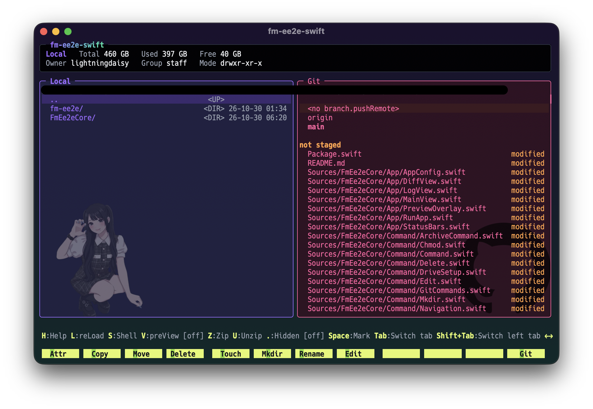
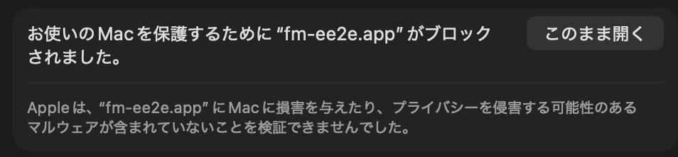

# fm-ee2e-swift



Mac のファイルを、キーボードだけでサクサク整理するアプリです。

窓が左右に分かれていて、ファイルのコピー・移動・削除・名前の変更が、キーを押すだけでできます。右の窓は、Google Drive・Git・SSH・iCloud Drive にも切り替えられます。Google Drive には、ファイルを **暗号化して**（自分にしか読めない形にして）しまっておけます。

Mac 専用です。

---

## インストールして起動する

### 1. ダウンロードする

1. ブラウザで https://github.com/minor-mn/fm-ee2e-swift/releases を開きます。
2. いちばん上にある `fm-ee2e-swift-v〜.zip` を押してダウンロードします。
3. 「ダウンロード」フォルダーにできた zip をダブルクリックします。`fm-ee2e-swift-v〜` というフォルダーができて、中に `fm-ee2e.app` と `fm-ee2e` フォルダーが入っています。

### 2. 初期設定

`command` を押しながら `スペース` を押して、`ターミナル` と打って `return` を押します。

`cd ` と打ってから（`cd` のあとに半角スペースを1つ）、Finder から `fm-ee2e-swift-v〜` フォルダーをターミナルの画面にドラッグして `return` を押します。

続けて、次の灰色の枠の中の文字をまとめてコピーしてターミナルに貼り付け、`return` を押します。

```bash
mkdir -p ~/.config
cp -R fm-ee2e ~/.config/
```

### 3. アプリをアプリケーションフォルダーに入れる

Finder で、`fm-ee2e.app` を「アプリケーション」フォルダーにドラッグします。

### 4. 起動する

「アプリケーション」フォルダーにある **fm-ee2e** をダブルクリックします。

初めてのときは「"fm-ee2e.app" は開いていません」と出るので、**完了** を押します。そのあと、

1. 「システム設定」→「プライバシーとセキュリティ」を開いて、下のほうへスクロールします。
2. 次のところの **このまま開く** を押します。

   

3. もう一度 **fm-ee2e** をダブルクリックして、出てきた画面でも **このまま開く** を押します。

2回目からは、ダブルクリックだけで開きます。

左右の窓にファイルが並べば成功です。

- `↑` `↓` でファイルを選び、`←` `→` で左右の窓を行き来します。
- `H` を押すと、キーの一覧が出ます。
- 終わるときは、窓の左上の赤いボタンを押します。

---

## 右の窓のタブを使えるようにする

`Tab` を押すと、右の窓が次の順に切り替わります。

**Google Drive → Git → SSH → iCloud Drive → ローカル**

ローカル（この Mac の中のファイル）は、何もしなくても使えます。ほかのタブは、使いたいものだけ準備してください。使わないタブは、「設定を変更する」で消せます。

### Google Drive

Google Drive に、ファイルの名前と中身を暗号化してしまっておけます。ブラウザで Google Drive を見ても、何のファイルか分かりません。

**1. Google ドライブ for デスクトップを入れる**

次のページからダウンロードしてインストールし、Google アカウントでログインします。

https://ipv4.google.com/intl/ja/drive/download/

**2. 鍵を作る**

アプリの右の窓を「Google Drive」にすると、「鍵ファイルがありません」と出ます。`return` を押して、**新しい鍵を生成** を選びます。

鍵は、暗号化したファイルを元に戻すためのものです。`~/.config/fm-ee2e/.fm-ee2e.key` というファイルに保存されます。

> **鍵をなくすと、暗号化したファイルは二度と読めません。** USB メモリやパスワード管理アプリなど、別の場所に必ずコピーを取っておいてください。
>
> ほかの Mac でも同じファイルを読みたいときは、その Mac では **既存の鍵をペースト** を選んで、`.fm-ee2e.key` の中身を貼り付けます。

これで、Google Drive の「マイドライブ」の中に `fm-ee2e` というフォルダーができて、右の窓にその中が出ます。左の窓でファイルを選んで `G` を押すと、暗号化して Google Drive に送れます。

### Git

Git が入っていないときは、ターミナルで次を実行して「インストール」を押します（数分かかります）。

```bash
xcode-select --install
```

右の窓を「Git」にすると、**左の窓で開いているフォルダー**の Git の状態が出ます。左の窓で、Git で管理しているフォルダーを開いてください。

### SSH

ほかのコンピューター（サーバー）のファイルを、右の窓で見られます。

ホームフォルダーの `.ssh/config` というファイルに、つなぎ先を書いておきます。

```
Host myserver
  HostName example.com
  User yourname
```

ターミナルで `ssh myserver` と打ってつながれば準備完了です。つなぎ先の名前やユーザー名、鍵は、つなぎ先を用意した人に聞いてください。

右の窓を「SSH」にすると `myserver` のようにつなぎ先が並ぶので、選んで `return` を押すとつながります。

### iCloud Drive

Mac の「システム設定」→ いちばん上の自分の名前 →「iCloud」→「iCloud Drive」で、**この Mac を同期** をオンにします。

右の窓を「iCloud Drive」にすると、iCloud Drive のファイルが並びます。

---

## 設定を変更する

設定は `~/.config/fm-ee2e/config.json5` に書きます。次でテキストエディットが開きます。

```bash
open -e ~/.config/fm-ee2e/config.json5
```

- 書き換えて保存し、アプリに戻ると、すぐに反映されます。
- `"` は半角の `"` のまま書きます。テキストエディットが `“` `”` に変えてしまうときは、「編集」→「自動置換」→「スマート引用符」のチェックを外してください。
- 書き間違いがあると、アプリに戻ったときに知らせが出て、前の設定のままになります。

### 日本語にする

最初は英語で表示されます。いちばん上の `language` を `"ja"` に変えると、日本語になります。

```json5
  language: "ja",
```

### 使わないタブを消す

`right_tabs` で `false` にしたタブは、出てこなくなります。たとえば SSH と Git を使わないなら、次のようにします。

```json5
  right_tabs: {
    google_drive: true,
    git: false,
    ssh: false,
    icloud: true,
    local: true,
  },
```

### 見た目を変える

`appearance` の中に、見た目を書きます。色は `"#FF5FA0"` のように書きます。

| ブロック | 何に効くか | 主に変えられるもの |
|---|---|---|
| `window` | 窓全体 | 透け具合（`opacity`）、後ろのぼかし（`blur`）、背景のグラデーション、上の帯の背景、下に出る知らせの文字の色、文字の種類と大きさ（`font`） |
| `default` | すべてのタブ | 文字の色、先頭の場所（パス）の色 |
| `local`・`git`・`ssh`・`google_drive`・`icloud` | そのタブだけ | 背景の色、背景の画像、枠の色（`accent`）、文字の色、Git の一覧や差分の色 |

- タブのブロックに書いていないものは、`default` の値、`default` にもなければ `window` の値が使われます。
- 背景の画像は、`~/.config/fm-ee2e/images` に画像を置いて、そのパスを `path` に書きます。
- Google Drive と iCloud Drive のタブの上の帯には、開いているフォルダーの中身の合計の大きさ（Used）が出ます。フォルダーを開くたびに中を全部数えるので、ファイルがとても多くて動きが重いと感じたら、`google_drive` や `icloud` のブロックに `show_used: false` を書くと、数えるのをやめて軽くなります。
---

## アプリを自分で作る

ダウンロードしたアプリの代わりに、自分で作ることもできます。

1. https://github.com/minor-mn/fm-ee2e-swift の緑の **Code** ボタンから **Download ZIP** を押して、できた zip をダブルクリックします。
2. ターミナルで開発ツールを入れます。

   ```bash
   xcode-select --install
   ```

   `swift --version` で `Swift version 6.4` 以上の数字が出れば OK です。

3. アプリを作ります。

   ```bash
   cd ~/Downloads/fm-ee2e-swift-main
   sh scripts/make-app.sh
   ```

   最後に `.build/fm-ee2e.app` と出たら完成です。

4. 初期設定をして、アプリをアプリケーションフォルダーに入れます。

   ```bash
   mkdir -p ~/.config
   cp -R fm-ee2e ~/.config/
   cp -R .build/fm-ee2e.app /Applications/
   ```

自分で作ったアプリは、「このまま開く」を押さなくても開けます。
